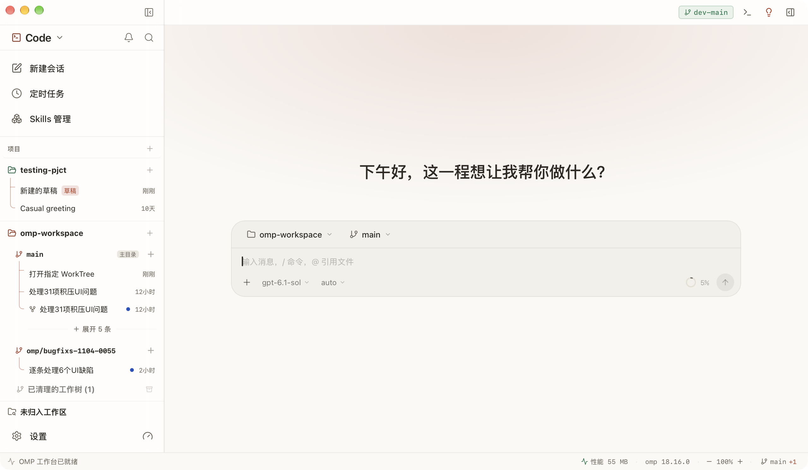

<div align="center">


# Vecway

**The Native Desktop GUI & Intelligent Routing Workbench for [`oh-my-pi` (`omp`)](https://github.com/can1357/oh-my-pi) AI Coding Agents.**  
专为 [`oh-my-pi`（`omp`）](https://github.com/can1357/oh-my-pi) 智能体打造的现代化原生桌面 GUI 与智能路由工作台。

[](https://github.com/qian-123456/vecway/releases)
[-0f172a?style=flat-square)](https://github.com/can1357/oh-my-pi)
[](https://github.com/qian-123456/vecway)
[](https://tauri.app/)
[](LICENSE)

[English](#english) | [中文说明](#中文说明) | [User Guide](docs/guide/en) | [中文手册](docs/guide/zh) | [`llms.txt`](llms.txt)

<br/>



</div>

---

<a name="english"></a>
## English

**Vecway** *(formerly `omp-workspace` / `omp-studio`)* is a fast, native desktop GUI and multi-path routing workbench built for [`oh-my-pi` (`omp`)](https://github.com/can1357/oh-my-pi) AI coding agent sessions. Engineered with **Tauri 2, Rust, React 19, TypeScript, and Tailwind CSS v4**, it turns raw terminal agent power into a calm, structured desktop workspace.

Vecway works **alongside** the `omp` CLI rather than replacing it: terminal sessions under `~/.omp/agent/sessions/` appear in the sidebar in real time, and any desktop session can be taken over in your terminal whenever you want.

### ⚡ Quick Facts

| Attribute | Details |
|---|---|
| **Product** | **Vecway** (formerly `omp-workspace` / `omp-studio`) |
| **Underlying Agent CLI** | [`oh-my-pi` (`omp`)](https://github.com/can1357/oh-my-pi) — full bidirectional session sync |
| **Core Philosophy** | **Vector × Way** — Case-by-case intelligent routing across models, branches, and workflows |
| **Platform** | macOS 12+ (Apple Silicon & Intel) |
| **Stack** | Tauri 2 · Rust · React 19 · TypeScript · Tailwind CSS v4 |
| **License** | MIT |

### 🔀 Why Vecway? — The Case-by-Case Routing Philosophy

Complex engineering rarely fits a single linear chat or one fixed model. Vecway embeds **routing** into every layer of the workbench:
- **Model Role & Fallback Routing**: Route Main, Lightweight, Vision, and Consultant tasks to the right models automatically, backed by quota-triggered fallback chains.
- **Git Worktree Parallel Routing**: Route concurrent coding tasks into isolated Git worktrees and branches so multiple `omp` agents never step on each other's files.
- **Conversation Tree & Side-Chat Routing**: Fork sibling branches, step back cleanly, or peel off quick questions into a lightweight Side Chat without polluting your main context window.
- **Session Attention Inbox & Doctor**: Route all approvals, runtime questions, and errors into one Inbox, and let a lightweight Session Doctor audit long runs for prompt and cost waste.

### 🌟 Key Features

#### 1. 🗂️ Unified Agent Session Hub
- **Bi-directional Synchronization**: Monitors `~/.omp/agent/sessions/` in real time. Sessions started in CLI show up immediately, and vice versa.
- **Multi-space Workspace**: Partition workflows by focus: `Code`, `Work`, `Study`, `Research`, and `Universal`.
- **Session Lifecycle & Status Engine**: Clear visual indicators for *Running*, *Awaiting Input/Approval*, *Awaiting Review*, *Idle*, *Error/Interrupted*, and *External Takeover*.
- **Smart Idle Suspend**: Automatically suspends idle sessions to free up system RAM; wakes up in milliseconds the instant you send a message.

#### 2. 💬 Full Execution Trace & Interactive Composer
- **Visual Trace**: Unfold reasoning/thinking steps, structured tool-call parameters, outputs, and live git diffs.
- **Cross-surface Annotation**: Highlight any line of code or text in the chat, click annotate, and send it directly back to the input box with precise quotes.
- **Side Chat**: A lightweight, distraction-free auxiliary dialogue pane for quick questions without polluting your main session context.
- **Conversation Tree**: Sibling branching, step-back navigation, and edit-resend. Editing wakes suspended sessions and restores the original text without waiting for background history refreshes.
- **Plan Mode**: Visual checklist tracking step-by-step agent task planning and execution progress.

#### 3. 🌿 Git Worktree Multi-Agent Parallelism
- **Zero-collision Coding**: Spawn multiple agents on different branches or isolated Git Worktrees simultaneously on the same repository.
- **Time-Machine Checkpoints**: Auto-snapshot every turn with instant preview and safe point-in-time recovery.
- **Diff & Branch Inspector**: Inspect uncommitted changes and branch switches at a glance.

#### 4. 🛠️ Integrated Workspace Tooling
- **Project File Explorer**: Fast tree view with fuzzy filtering (`⌘F`) and native Finder integration.
- **Dual-Pane Document Viewer**: CodeMirror powered editor and rendered Markdown viewer side-by-side with chat.
- **Persistent Multi-tab Terminal**: Built-in PTY terminal that can collapse background servers into background service chips.
- **Port & Service Guard**: Detects open development ports and terminates stray zombie processes with one click.

#### 5. ⏰ Automation, Inbox & Backlog
- **Scheduled Tasks (Cron)**: Automate daily standup summaries, dependency security audits, or TODO sweeps; runs safely in dedicated isolated worktrees.
- **Session Attention Inbox**: Centralized hub (the bell icon) aggregating all sessions needing your attention (tool approvals, questions, runtime errors, interrupted sessions, and unread reviews).
- **Idea Backlog**: Global shortcut to quickly jot down inspirations and bugs, with one-click agent dispatching.

#### 6. 🧠 Model Governance & Agent Settings
- **Unified Providers**: Full support for API Keys, custom OpenAI-compatible base URLs, and OAuth subscriptions.
- **Readable Model Selection**: A grouped, scrollable two-pane picker keeps provider names and model identifiers accessible; thinking controls use the selected model's catalog and runtime capabilities.
- **Role Precedence & Fallback Chains**: Assign specialized models for Main, Lightweight, Vision, and Consultant roles, backed by automated retry chains.
- **Custom Subagents**: Create specialized subagent personas with built-in "Help me draft" assistant.
- **Privacy Vault**: Mask sensitive API keys, tokens, and corporate credentials before they hit LLMs.

#### 7. 📊 Deep Doctor & Mobile Remote Access
- **Token Usage Breakdown**: Context water-gauge meter with 5-category cost decomposition (Tool calls, Skills, System Prompt, MCP, Reasoning/Output).
- **Session Doctor**: Independent lightweight model analyzing long sessions across 4 axes: Cost Optimization, Prompt Tuning, Code Traps, and Free Audit.
- **Mobile Access**: Pair your phone via local LAN, Cloudflare Tunnel, or IPv6 HTTPS for on-the-go progress tracking and approvals.

---

### 📦 Download and Install

Download the latest release for your Mac architecture from [GitHub Releases](https://github.com/qian-123456/vecway/releases/latest):

| Architecture | Chip / Hardware | Installer Asset |
|---|---|---|
| **Apple Silicon** (Recommended) | M1 / M2 / M3 / M4 / M5 series Mac | `Vecway_<version>_aarch64.dmg` |
| **Intel Mac** | Older Intel-based Mac | `Vecway_<version>_x64.dmg` |

> ⚠️ **Important: "Vecway is damaged and can't be opened"**
>
> Because open-source community builds are not signed with a paid Apple Developer certificate, macOS Gatekeeper may show:
> `“Vecway” is damaged and can’t be opened. You should move it to the Trash.`
>
> **The app is NOT damaged.** Run this command in Terminal to clear the quarantine flag:
> ```bash
> xattr -cr /Applications/Vecway.app
> ```
> *Alternative*: Right-click (Control-click) `Vecway.app` in Finder, choose **Open**, or go to **System Settings ▸ Privacy & Security** and click **Open Anyway**.

---

### 🛠️ Build from Source

**Requirements**: macOS 12+, Node.js 18+, `pnpm`, and Rust 1.85+.

```bash
# Clone the repository
git clone https://github.com/qian-123456/vecway.git
cd vecway

# Install dependencies and start development mode
pnpm install
pnpm tauri dev

# Build production macOS application bundle (.dmg)
pnpm build:app
```

#### Local Rust builds: official Cargo + Kache

Local builds on this Mac use official Cargo (the rustup proxy at `~/.cargo/bin/cargo`) with pinned Kache **2.0.0** installed at `~/.local/share/omp-workspace/kache/2.0.0/bin/kache`. There is no alternate Cargo installation or opt-in build command. Use the regular `pnpm tauri dev`, `pnpm dev:preview`, and `pnpm build:app` commands above.

The user's Cargo configuration is the single source of compiler-cache selection. Configure `~/.cargo/config.toml` (or `$CARGO_HOME/config.toml` when explicitly using a different Cargo home) with an **absolute** executable path; Cargo does not expand `~` in this value:

```toml
[build]
rustc-wrapper = "/absolute/path/to/.local/share/omp-workspace/kache/2.0.0/bin/kache"
```

Install the matching `kache-engine` beside `kache`. Tool installation and user configuration are managed separately; repository launchers never download or update tools. This Mac's Kache configuration uses a permanent shared local-only store at `~/.local/share/omp-workspace/kache-cache`, a 10 GiB blob budget, and no automatic target-directory deletion. The cache budget is not a hard limit on peak build disk use; official Cargo still keeps final outputs in each worktree's target directory.

All project Tauri entry points run through `scripts/tauri.mjs`, which puts `$CARGO_HOME/bin` (defaulting to the official `~/.cargo/bin`) first on `PATH`, selects its Cargo executable (`cargo.exe` on Windows), and **removes** inherited `RUSTC_WRAPPER`, `RUSTC_WORKSPACE_WRAPPER`, `CARGO_BUILD_RUSTC_WRAPPER`, and `CARGO_BUILD_RUSTC_WORKSPACE_WRAPPER` overrides so the user's Cargo configuration wins. Removing these variables is intentional: an empty `RUSTC_WRAPPER` would disable the configured cache. `scripts/open-worktree.mjs` uses this same entry point.

For direct Cargo commands, remove old wrapper overrides in the calling shell first:

```bash
source ~/.cargo/env
unset RUSTC_WRAPPER RUSTC_WORKSPACE_WRAPPER \
  CARGO_BUILD_RUSTC_WRAPPER CARGO_BUILD_RUSTC_WORKSPACE_WRAPPER
cargo check --manifest-path src-tauri/Cargo.toml
```

New worktrees need the current tracked launchers and package commands; uncommitted main-checkout changes do not propagate through `git worktree add`. Existing running applications do not need restarting for this configuration change, but already-loaded agent instructions and custom shell commands may still contain obsolete wrapper exports. Clear those exports before issuing direct Cargo commands. Fingerprinted statechart audit documents and saved evidence describe their historical baseline, not the current cache policy. CI release builds keep their existing official-Cargo policy.

### ❓ FAQ

- **What is the desktop GUI for `oh-my-pi` (`omp`)?**  
  **Vecway** (formerly `omp-workspace` / `omp-studio`) is a community-built native desktop GUI and workbench for `oh-my-pi` (`omp`). If you do not have `omp` installed yet, Vecway can install it automatically on first launch.
- **Does Vecway replace my `omp` terminal workflow?**  
  No. Both Vecway and the `omp` CLI share `~/.omp/agent/sessions/` and `~/.omp/agent/models.yml`, so you can switch seamlessly between terminal and GUI on the same session.
- **Will upgrading from `omp-workspace` keep my existing local settings and history?**  
  Yes. Vecway preserves the local data directory (`~/.omp-workspace/`) and application identifier (`ai.omp.workspace`) for seamless continuity.

---

<a name="中文说明"></a>
## 中文说明

**Vecway**（原名 `omp-workspace` / `omp-studio`）是专为 [`oh-my-pi`（`omp`）](https://github.com/can1357/oh-my-pi) 智能体命令行引擎打造的高性能原生桌面 GUI 与智能路由工作台。采用 **Tauri 2 + Rust + React 19 + TypeScript + Tailwind CSS v4** 技术栈构建，将命令行的硬核能力与原生桌面的清晰秩序融为一体。

工作台与终端 `omp` 紧密协作而非割裂替代：终端中创建的会话会实时呈现在左侧栏，桌面发起的任务亦可随时在终端中无缝续接。

### 🔀 设计哲学：Vector × Way（因境择路）

复杂研发从来不是一条直线走到底——Vecway 把**“分情况路由、走最优路径、留兜底方案”**的思维贯穿在产品每一层：
- **模型角色与额度路由**：为主力、轻量、视觉、顾问等不同角色指派专属模型，并配置额度触发的自动降级回退链。
- **Git Worktree 并行隔离路由**：为不同任务自动路由到独立的工作树与分支目录，多智能体同时编码互不踩踏。
- **分支对话树与侧聊分流**：随时在历史节点分叉回溯，或把临时旁枝问题分流到轻量级 Side Chat，不污染主上下文。
- **全盘注意力调度与体检**：把所有审批、报错与待回复统一路由进收件箱（Inbox），并用独立轻量模型为长会话做成本与提示词体检。

### 🌟 核心特性全景

#### 1. 🗂️ 智能体多会话中心
- **双向无缝同步**：毫秒级监控 `~/.omp/agent/sessions/`，无论是终端命令还是桌面操作，会话双向实时一致。
- **多空间工作区**：专为深度研发打造五大空间体系（`Code` 代码研发、`Work` 事务协作、`Study` 学习阅读、`Research` 方案调研、`Universal` 自由对话）。
- **完整会话状态机**：运行中、待回复/审批、待验收、空闲、报错中断、外部终端接管等状态一目了然。
- **智能闲置休眠**：长时间闲置的会话自动进入内存挂起状态，发消息时即刻毫秒级唤醒，几十个会话同时开启依然流畅轻盈。

#### 2. 💬 可视化执行追踪与交互
- **全链路追踪卡片**：智能体思考过程（Thinking）、工具调用输入参数与执行结果结构化折叠，代码 Diff 实时审查。
- **跨界面划选批注**：选中聊天记录或代码中任意语句，点击批注即可带着上下文一键反向引用发回输入框。
- **辅助对话（Side Chat）**：轻量级独立侧聊面板，随时对智能体提出周边问题，完全不污染主会话上下文。
- **分支对话树**：随时切换同级分支版本，支持历史轮次回溯与编辑重发；编辑会唤醒已挂起的会话，原文回填不再等待后台历史刷新。
- **计划模式（Plan Mode）**：步骤化展示复杂任务的实施方案，实时勾选推进进度。

#### 3. 🌿 Git Worktree 独立工作树并行开发
- **多 Agent 零冲突协作**：基于原生 Git Worktree 隔离机制，多个智能体可在同一仓库的不同分支或工作树下并行编码，绝不踩踏工作区。
- **时光机版本快照（Checkpoints）**：每轮交互自动生成版本快照，随时支持历史改动预览与一键安全回溯。
- **变更一览**：未提交改动审查、文件 Diff、工作树状态实时感知。

#### 4. 🛠️ 内置工作区工具链
- **项目文件树**：树状浏览工作区文件，支持 `⌘F` 实时模糊过滤，与 macOS 访达深度联动。
- **代码与文档分栏视图**：基于 CodeMirror 的多语言编辑器与 Markdown 沉浸式阅读器，支持与聊天双栏同屏。
- **内置持久化终端**：基于 PTY 的多标签交互式终端，可将正在运行的服务器一键折叠收纳为后台服务。
- **端口与服务治理**：自动扫描本机端口占用，快速识别开发服务器，一键清理残留僵尸进程。

#### 5. ⏰ 自动化巡检、收件箱与想法收集
- **周期定时任务（Cron）**：支持每日晨会准备、依赖安全巡检、TODO 盘点等模板，支持在独立 Worktree 中全自动或受控运行。
- **会话通知中心（Inbox）**：点击左侧栏顶部的铃铛图标，跨项目聚合所有需要人工介入的会话动态（待审批、智能体提问、运行报错、异常中断与待验收完成），支持键盘极速穿梭直达目标会话。
- **随手想法收集箱（Backlog）**：全局快捷键随时唤出捕获灵感与缺陷，支持带截图与上下文一键派发给 Agent。

#### 6. 🧠 模型治理与智能体体系
- **多供应商接入**：原生支持 API Key、自定义 Base URL 兼容网关与 OAuth 订阅账号统一配置。
- **完整模型选择信息**：可滚动双栏选择器保留供应商名称与模型标识，思考选项依据所选模型的目录和运行时能力显示。
- **模型角色分工与回退链**：支持为主力、轻量、视觉、深度思考等角色分配最佳模型，并配置自动降级重试回退链。
- **自定义子代理**：可视化创建与管理专属 Agent，内置“让 AI 帮我写”快速起草智能体设定。
- **隐私脱敏库**：敏感配置与密钥在发送给大模型前自动占位脱敏，保护企业与个人资产安全。

#### 7. 📊 深度体检与手机远程互联
- **Token 用量分析**：直观的上下文水位计，精准拆解工具调用、技能注入、系统提示词、MCP 与思考开销五大维度。
- **会话深度体检（Session Doctor）**：由独立轻量模型回看长会话，针对「省钱瘦身」、「提问调优」、「代码暗坑」开具诊断单并生成一键纠偏提示词。
- **全场景手机远程访问**：支持同一局域网扫码直连、Cloudflare Tunnel 隧道穿透或 IPv6 直连，手机端随时查看进展与远程审批。

---

### 📥 下载与安装

请前往 [GitHub Releases 最新发布页](https://github.com/qian-123456/vecway/releases/latest) 下载对应芯片的安装包：

- **苹果 M 系列芯片（Apple Silicon: M1/M2/M3/M4/M5）**：下载 `Vecway_<version>_aarch64.dmg`（绝大多数用户推荐）
- **老款 Intel 芯片**：下载 `Vecway_<version>_x64.dmg`

> ⚠️ **重要：若提示“已损坏，无法打开。你应该将它移到废纸篓”**
>
> 这是因为开源社区构建尚未购买苹果昂贵的商业开发者证书，macOS Gatekeeper 安全机制会自动给下载的文件打上隔离标记（Quarantine）。**软件本身没有任何损坏**。
>
> 只需要打开 macOS「终端（Terminal）」，执行以下命令即可清除隔离标记并正常开启：
> ```bash
> xattr -cr /Applications/Vecway.app
> ```
> *免终端替代方案*：在访达「应用程序」中按住 `Control` 键点按应用选择「打开」，或在系统「系统设置 ▸ 隐私与安全性」中点击「仍要打开」。

---

### 💻 源码编译与本地开发

**运行环境**：macOS 12+，Node.js 18+，`pnpm`，Rust 1.85+。

```bash
# 1. 克隆代码仓库
git clone https://github.com/qian-123456/vecway.git
cd vecway

# 2. 安装前端依赖
pnpm install

# 3. 启动本地开发模式（构建 Rust 后端 + Vite 前端热重载）
pnpm tauri dev

# 4. 打包 macOS 正式版应用安装包 (.app / .dmg)
pnpm build:app
```

开发辅助命令：
```bash
pnpm tsc --noEmit    # 前端 TypeScript 类型检查
pnpm vitest run      # 前端单元测试
cd src-tauri && cargo clippy  # 后端 Rust 代码检查
```

---

### ❓ 常见问题（FAQ）

- **这是不是 `oh-my-pi`（`omp`）的桌面客户端 / GUI？**  
  是的。**Vecway**（原 `omp-workspace` / `omp-studio`）正是专为 `omp` 命令行智能体打造的社区原生桌面 GUI 与多路径路由工作台。未安装 `omp` 时，首次启动工作台会自动完成安装。
- **改名为 Vecway 后，之前 `omp-workspace` 的配置和会话会丢吗？**  
  不会。Vecway 完整保留了本地数据目录（`~/.omp-workspace/`）和系统级应用标识，升级覆盖即可无缝延续所有会话与设置。

---

### 📖 文档与指引

- 完整使用指南：[`docs/guide/zh/`](docs/guide/zh)（中文版）、[`docs/guide/en/`](docs/guide/en)（英文版）
- AI 检索索引文件：[`llms.txt`](llms.txt)
- 系统架构与模块契约：[`docs/ARCHITECTURE.md`](docs/ARCHITECTURE.md)
- 发版与 Release 规范：[`docs/RELEASE_GUIDE.md`](docs/RELEASE_GUIDE.md)
- 贡献者与智能体工作纪律：[`AGENTS.md`](AGENTS.md)

---

### 📄 开源许可证

本项目采用 [MIT 许可证](LICENSE) 开源。
